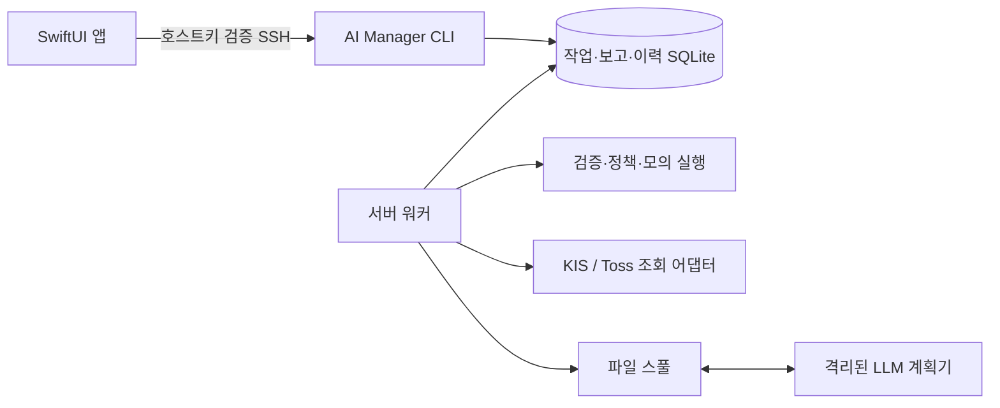

# 구조와 설계

앱과 CLI는 서버의 같은 결과를 읽습니다. 지시는 접수 상태와 결과를 저장하고,
앱을 닫아도 서버 워커가 이미 접수된 작업을 처리합니다. 전송이 불확실한 요청은
같은 ID로 재확인합니다. 부수효과가 있는 외부 주문 전체의 exactly-once를 보장하는 구조는 아닙니다.

LLM은 주문 실행 주체와 분리합니다. 계획기에는 브로커 인증·계좌 DB·Docker 소켓을
마운트하지 않고 파일 스풀로 필요한 요청과 응답만 교환합니다. 응답은 구조와 정책을
검사하며 현재 매니저의 자동 실행은 모의 실행만 지원합니다.

아이폰은 호스트 공개키를 고정해 서버를 검증합니다. 개인키와 암호는 기기 전용
Keychain에 저장합니다. SSH 터미널은 로그인 계정의 셸 권한으로 동작하며 별도
웹 터미널이나 공개 HTTP API를 운영하지 않습니다.

운영 데이터를 코드 릴리스와 분리하고 배포 테스트를 통과한 실행 버전으로 전환합니다.
복구는 코드·컨테이너에 적용하며 DB 스키마 변경에는 별도 마이그레이션 정책이 필요합니다.

다음 과제는 실계좌 통합 원장·NAV, 전체 주문 경로의 통제 통합,
장기 전략 검증과 APNs 수신 검증입니다.
